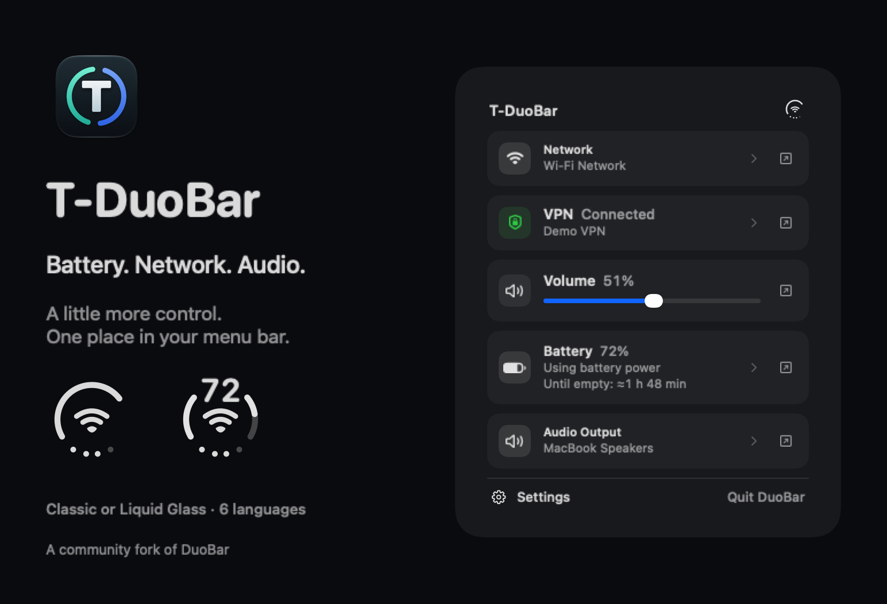
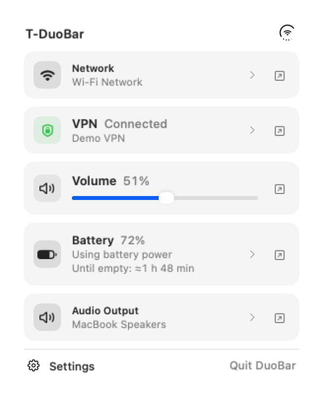
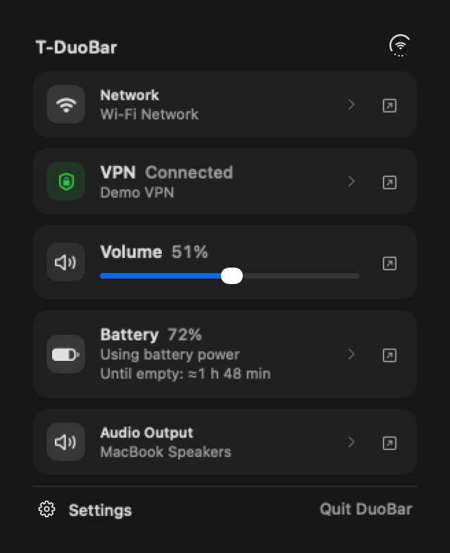
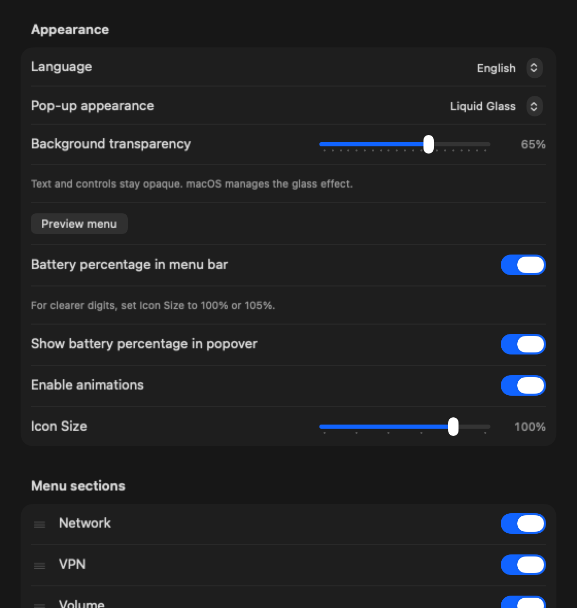

<p align="center">
  
</p>
<h1 align="center">T-DuoBar</h1>
<p align="center"><strong>Battery, network and audio — one place in your menu bar.</strong></p>
<p align="center">
  
  
  <a href="LICENSE"></a>
  <a href="https://github.com/squazaryu/T-DuoBar/releases/tag/v1.12.1"></a>
</p>
<p align="center"><a href="https://github.com/squazaryu/T-DuoBar/releases/tag/v1.12.1">Download</a> · <a href="README.ru.md">Русский</a> · <a href="docs/COMPARISON.md">Compare forks</a> · <a href="DEVELOPMENT.md">Source &amp; build</a></p>



An independent community fork of [DuoBar by Mike Li (Mikeli7666)](https://github.com/Mikeli7666/DuoBar). Keep battery, network and audio together in one menu bar indicator, with a more capable pop-up when you need the details.

## Why T-DuoBar

- **A readable, configurable glyph.** Choose the circular icon or add battery digits in an adaptive cutout. Both use the same full-size center symbol and circular volume dots. Digits render at native pixel-aligned size; a green power ring omits the redundant bolt.
- **Battery context.** Remaining time or time to full charge when macOS provides an estimate, accessory batteries and optional low-battery alerts.
- **Network and VPN at a glance.** Signal, band, channel, IP copying, Personal Hotspot indication and a separate VPN card with the macOS-reported profile and interface.
- **Useful audio controls.** Output selection, favorites, microphone selection, mute and optional scrolling over the menu bar icon to adjust volume. The four lower dots show output volume.
- **Your pop-up layout.** Reorder or hide sections; choose Classic or native Liquid Glass, adjust background transparency and preview the actual menu. Glass requires macOS 26+ and respects Reduce Transparency.
- **Six languages.** English, German, Russian, Ukrainian, Simplified Chinese and Traditional Chinese, with a system-language option.
- **Homebrew updates.** Weekly checks while the app is running, a clear installed/available version display and an explicit installation action.

## See it in action

| Light appearance | Dark appearance |
| --- | --- |
|  |  |

<details>
<summary>Appearance and general settings</summary>



</details>

*Native application-view renders with demonstration values. No personal desktop or connection data is shown. The menu screenshots use the classic background; the settings image shows the Liquid Glass option.*

## Install and update

[Download the 1.12.1 DMG](https://github.com/squazaryu/T-DuoBar/releases/download/v1.12.1/T-DuoBar-1.12.1.dmg?build=38) · [Release notes and SHA-256](https://github.com/squazaryu/T-DuoBar/releases/tag/v1.12.1)

```sh
brew install --cask squazaryu/tap/t-duobar
```

For an existing Homebrew installation, quit DuoBar, then run:

```sh
brew update
brew upgrade --cask squazaryu/tap/t-duobar
open /Applications/DuoBar.app
```

Settings → Updates can check manually or weekly and open Terminal to install through Homebrew, then restart the app. Checks run only while DuoBar is open; failed checks retry after six hours. Installation starts only after an explicit click. Homebrew is not installed automatically, and unrelated packages are not upgraded by the in-app install action.

If adopting a manually installed app, quit it and back up `/Applications/DuoBar.app` first. `--adopt` requires an identical copy; do not use `--force` to discard the existing app. Existing DuoBar preferences are shared and retained. The original app and this fork should not run simultaneously.

**Distribution status:** this is an experimental ad-hoc signed community build, without Developer ID signing or Apple notarization. Homebrew verifies SHA-256 but does not add notarization. An Internet-downloaded app may need [Apple's individual-app approval procedure](https://support.apple.com/en-us/102445). Do not disable system protections globally.

## What makes this fork different?

T-DuoBar keeps the four dots dedicated to **volume**, and builds out the battery/network/audio pop-up, VPN visibility, appearance settings, localization and Homebrew update flow. For example, [hummusaki/DuoBar](https://github.com/hummusaki/DuoBar#readme) focuses on configurable Bluetooth dots and classic/split-ring styles. Percentages and accessory readings also appear in other forks; we do not claim them as exclusive features.

See the [documented comparison with upstream and another fork](docs/COMPARISON.md), checked on 21 October 2026.

## New in 1.12.1 · build 38

Ethernet now uses the macOS-style ‹•••› status mark in the ring and Network section. Center icons are aligned within the ring when percentages are hidden; the percentage layout keeps its existing placement. Preferences are retained; no breaking changes or migrations.

[Release notes](release/1.12.1/RELEASE_NOTES_1.12.1.md) · [Validation and limits](release/1.12.1/VALIDATION.md)

## Privacy and practical limits

System readings are processed locally. There is no analytics backend or upload of battery, network or device readings. The updater makes an HTTPS request to the version manifest in our Homebrew tap. Selecting a microphone changes the Core Audio input device; it does not record audio.

VPN status includes only configured connections reported by macOS. It does not prove that all traffic is protected. A tunnel interface alone is not treated as proof of a VPN connection. Device battery data and time estimates depend on macOS/device support; missing readings remain explicit. T-DuoBar does not pair Bluetooth devices or join Wi-Fi networks, and the charge-limit readout is unavailable.

The 1.12.1 release passed 97 focused icon, ring geometry, charging, size and Homebrew update tests. Validation covers 19 center states at three sizes, including pixel-identical percentage positioning. Intel is compiled; runtime validation is on Apple Silicon. A full-suite pass and new long-duration battery-drain measurements are not claimed.

## Build, source and credits

[Development and local installation](DEVELOPMENT.md) · [MIT license](LICENSE) · [Original DuoBar](https://github.com/Mikeli7666/DuoBar)

Thanks to Mike Li for DuoBar and to [CTeipen](https://github.com/CTeipen) for the German translation. Historical upstream marketing material is retained separately; the images above are T-DuoBar-specific native renders.
