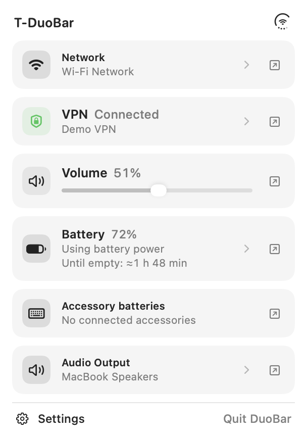
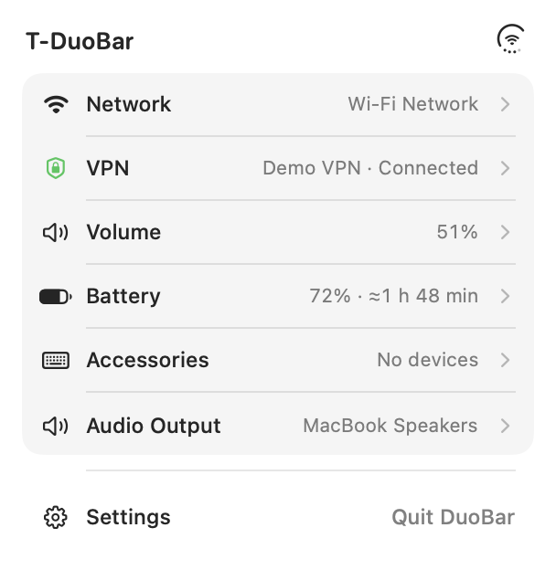
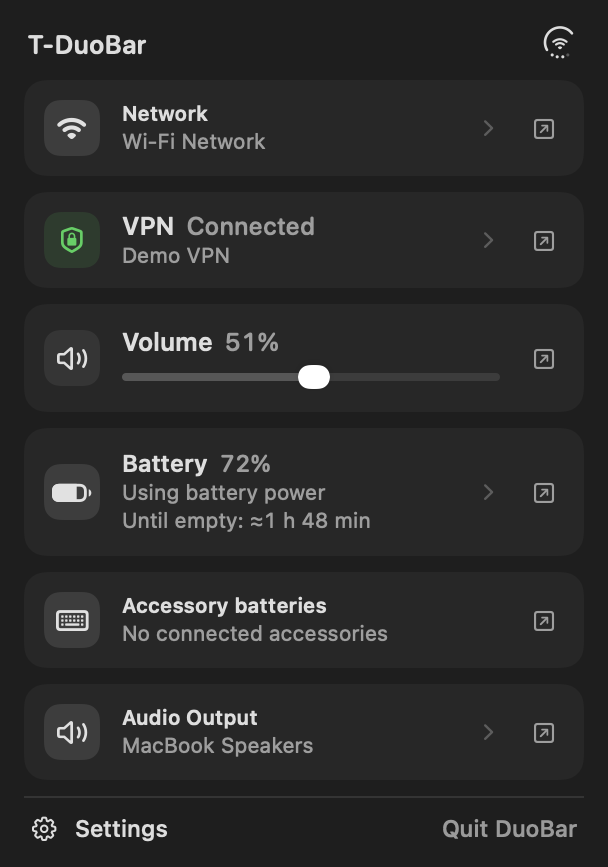
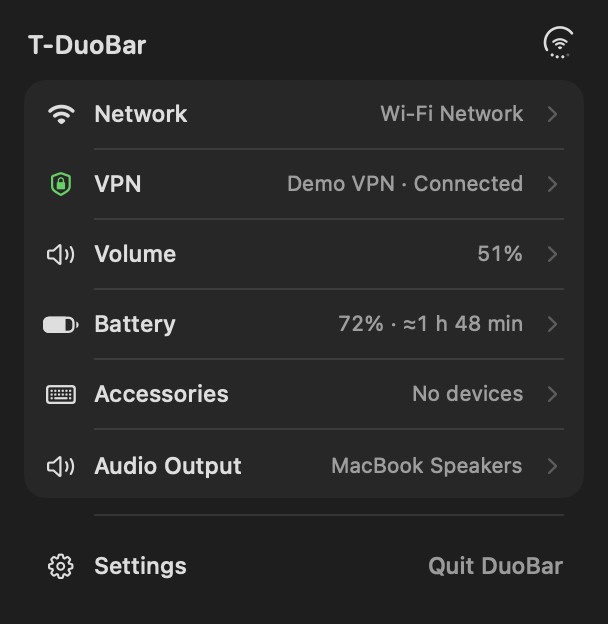
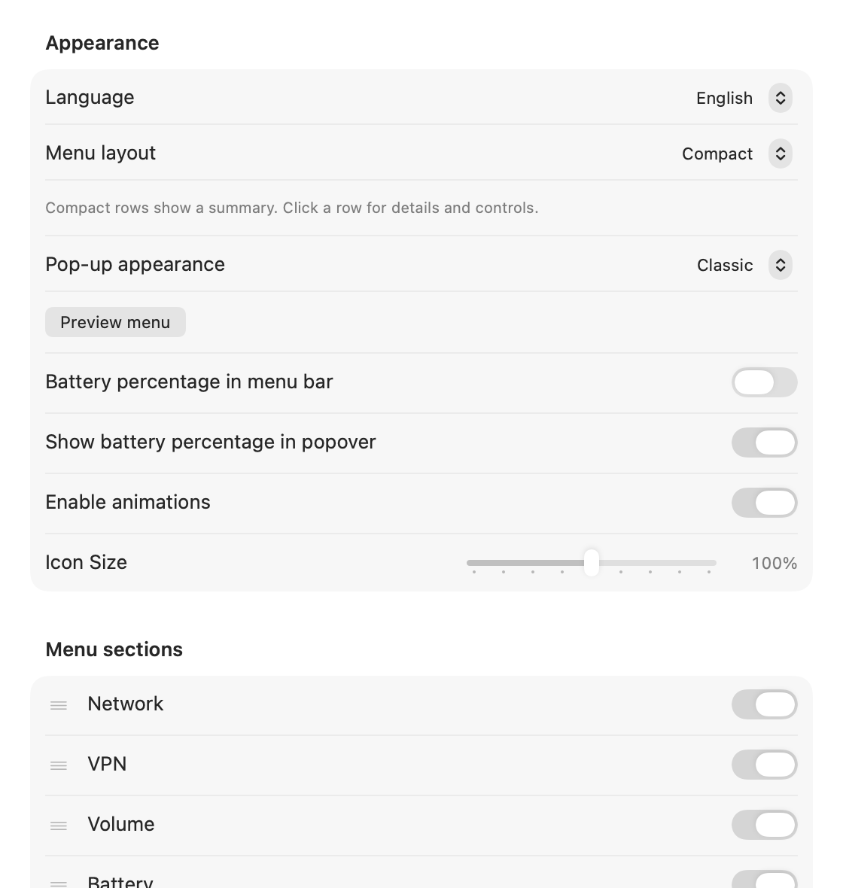
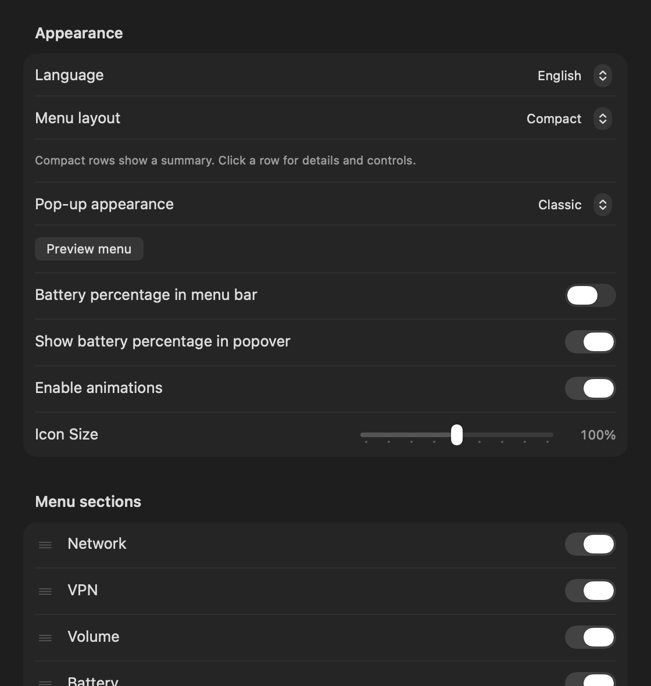

<p align="center">
  
</p>
<h1 align="center">T-DuoBar</h1>
<p align="center"><strong>Батарея, сеть и звук — в одном месте строки меню.</strong></p>
<p align="center">
  
  
  <a href="LICENSE"></a>
  <a href="https://github.com/squazaryu/T-DuoBar/releases/tag/v1.12.2"></a>
</p>
<p align="center"><a href="https://github.com/squazaryu/T-DuoBar/releases/tag/v1.12.2">Скачать</a> · <a href="README.md">English</a> · <a href="docs/COMPARISON.md">Сравнение форков</a> · <a href="DEVELOPMENT.md">Исходники и сборка</a></p>

Независимый общественный форк [DuoBar от Mike Li (Mikeli7666)](https://github.com/Mikeli7666/DuoBar). Батарея, сеть и звук объединены в одном значке строки меню, а подробности и управление доступны в pop-up.

## Что даёт T-DuoBar

- **Читаемый значок.** Круглый контур или проценты в адаптивном вырезе. В обоих режимах одинаковый крупный центральный символ и точки по окружности. Цифры рисуются в конечном размере с выравниванием по пикселям. При зелёном кольце молния скрыта.
- **Сведения о батарее.** Время до разрядки или полного заряда, если macOS предоставляет оценку; батареи аксессуаров и настраиваемые уведомления о низком заряде.
- **Сеть и VPN.** Сигнал, диапазон, канал, копирование IP, индикация мобильной точки доступа и отдельная карточка VPN с сообщаемыми macOS профилем и интерфейсом.
- **Управление звуком.** Выбор и избранные устройства вывода, микрофон, отключение звука и необязательная регулировка громкости прокруткой над значком. Четыре нижние точки показывают громкость.
- **Настраиваемое меню.** Порядок и видимость разделов, классическое оформление или нативный Liquid Glass, прозрачность фона и предпросмотр настоящего меню. Стекло требует macOS 26+ и учитывает «Уменьшить прозрачность».
- **Шесть языков.** Английский, немецкий, русский, украинский, упрощённый и традиционный китайский; также есть выбор языка системы.
- **Обновления через Homebrew.** Еженедельная проверка при запущенном приложении, понятные номера установленной и доступной версии и установка по нажатию.

## Два вида меню · превью следующей версии

**Новый интерфейс пока находится в локальной разработке и не входит в опубликованный DMG или Homebrew-сборку 1.12.2.** Ссылки ниже по-прежнему устанавливают 1.12.2.

**Обычный** вид сохраняет отдельные карточки и сразу доступный ползунок громкости. **Компактный** объединяет краткие строки в одну группу: нажатие раскрывает управление, устройства и ссылку на системные настройки. Порядок, видимость разделов и избранное общие для обоих вариантов.

| Обычный · светлая тема | Компактный · светлая тема |
| --- | --- |
|  |  |

| Обычный · тёмная тема | Компактный · тёмная тема |
| --- | --- |
|  |  |

В следующей версии выбор доступен в **Настройки → Основные → Внешний вид → Вид меню**. Обычный вид остаётся вариантом по умолчанию. Плотность меню выбирается независимо от фона Classic / Liquid Glass и его прозрачности — любой вид можно сочетать с любым материалом.

<details>
<summary>Превью: выбор вида меню в настройках</summary>

| Светлая тема | Тёмная тема |
| --- | --- |
|  |  |

</details>

<details>
<summary>Интерфейс опубликованной версии 1.12.2</summary>


| Светлая тема | Тёмная тема |
| --- | --- |
|  |  |


</details>

*Нативные рендеры интерфейса с демонстрационными значениями, без личных данных пользователя. Меню показано с фоном Classic; Liquid Glass на этих снимках не имитируется. Новые изображения относятся к сборке в разработке, а не к новому релизу.*

## Установка и обновление

[Скачать DMG 1.12.2](https://github.com/squazaryu/T-DuoBar/releases/download/v1.12.2/T-DuoBar-1.12.2.dmg?build=39) · [Релиз и SHA-256](https://github.com/squazaryu/T-DuoBar/releases/tag/v1.12.2)

```sh
brew install --cask squazaryu/tap/t-duobar
```

Для установленной через Homebrew версии: завершите DuoBar и выполните:

```sh
brew update
brew upgrade --cask squazaryu/tap/t-duobar
open /Applications/DuoBar.app
```

В «Настройки → Обновления» доступны ручная и еженедельная проверки. Кнопка установки открывает Terminal, обновляет приложение через Homebrew и запускает его снова. Проверки идут только при запущенном DuoBar; после сетевой ошибки повтор выполняется через шесть часов. Установка начинается по явному нажатию. Сам Homebrew автоматически не устанавливается; действие приложения не обновляет посторонние пакеты.

Перед первой установкой через Homebrew сохраните установленную вручную `/Applications/DuoBar.app`. `--adopt` подходит для идентичной копии; не используйте `--force`, чтобы потерять старую установку. Прежние настройки DuoBar сохраняются и используются совместно. Оригинал и форк не следует запускать одновременно.

**Статус распространения:** экспериментальная сборка с ad-hoc подписью, без Developer ID и Apple notarization. Homebrew проверяет SHA-256, но не добавляет нотариализацию. Для скачанного приложения macOS может потребовать [индивидуальное разрешение по инструкции Apple](https://support.apple.com/en-us/102445). Не отключайте системную защиту целиком.

## Отличия от других форков

Наш акцент — **громкость в нижних точках** и расширенный pop-up для батареи, сети и звука, видимость VPN, оформление, локализации и обновления через Homebrew. Например, [hummusaki/DuoBar](https://github.com/hummusaki/DuoBar#readme) делает акцент на настраиваемых Bluetooth-точках и классическом/split-ring оформлении. Проценты и батареи аксессуаров есть и в других форках — мы не заявляем их как исключительные возможности T-DuoBar.

[Сравнение документированных возможностей с оригиналом и другим форком](docs/COMPARISON.md), проверенное 21 октября 2026 года.

## Новое в 1.12.2 · сборка 39

Оптическое выравнивание значков сети, аудио и производительности в обоих режимах кольца; более компактный значок отсутствия сети. Оставшийся VPN-туннель без обычного подключения больше не вызывает ложный Other. Подсказка батареи при наведении убрана. Настройки сохраняются, миграций нет.

[Release notes](release/1.12.2/RELEASE_NOTES_1.12.2.md) · [Проверки и ограничения](release/1.12.2/VALIDATION.md)

## Приватность и ограничения

Системные показания обрабатываются локально. Аналитики и передачи данных батареи, сети и устройств нет. Проверка обновлений делает HTTPS-запрос к файлу версии в нашем Homebrew tap. Выбор микрофона меняет устройство ввода Core Audio; приложение не записывает звук.

VPN показывает только настроенные подключения, о которых сообщает macOS, и не гарантирует защиту всего трафика. Один лишь туннельный интерфейс не считается доказательством VPN. Показания аксессуаров и оценки времени зависят от macOS и оборудования; отсутствие данных обозначается явно. Опубликованная версия 1.12.2 не подключается к Wi-Fi-сетям и не выполняет сопряжение Bluetooth. Лимит заряда недоступен.

Для выпуска 1.12.2 пройдено 106 профильных тестов: выравнивание рисунков на 1×/2× и размерах 80–105%, зазоры до кольца, стабильность цифр и точек, сетевые состояния при оставшемся туннеле и обновления Homebrew. Реальное отключение Wi-Fi не выполнялось; переход проверен на тестовых данных. Intel проверен сборкой, запуск — на Apple Silicon. Полный прогон всех тестов и новые длительные замеры расхода батареи не заявляются.

## Исходники и авторы

[Разработка и локальная установка](DEVELOPMENT.md) · [MIT-лицензия](LICENSE) · [Оригинальный DuoBar](https://github.com/Mikeli7666/DuoBar)

Спасибо Mike Li за DuoBar и [CTeipen](https://github.com/CTeipen) за немецкий перевод. Исторические материалы оригинала сохранены отдельно; выше показан интерфейс T-DuoBar.
